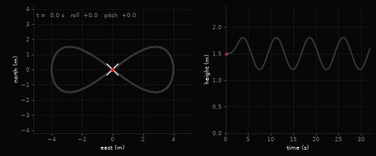
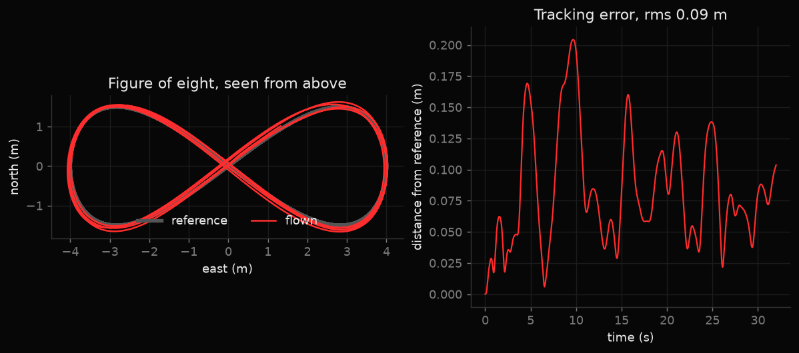
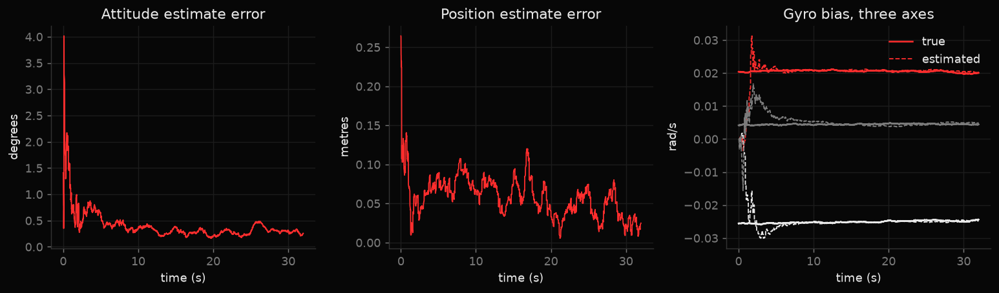
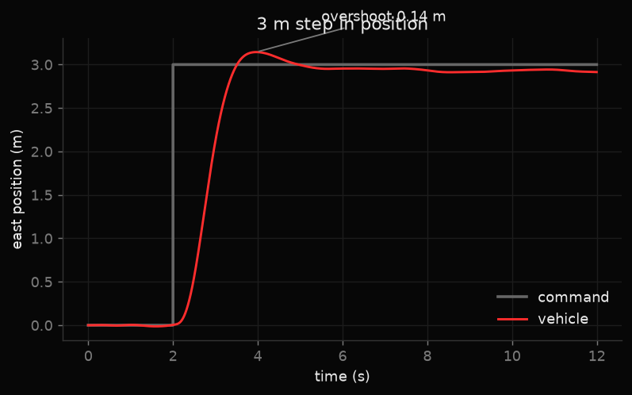
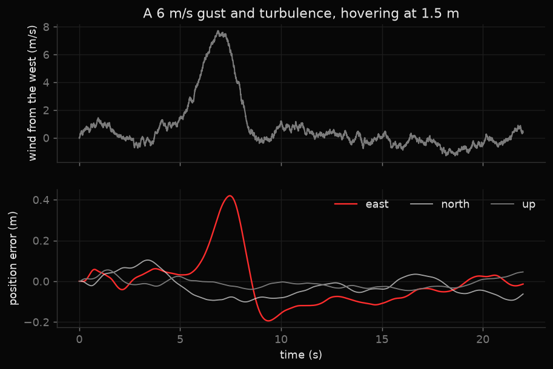
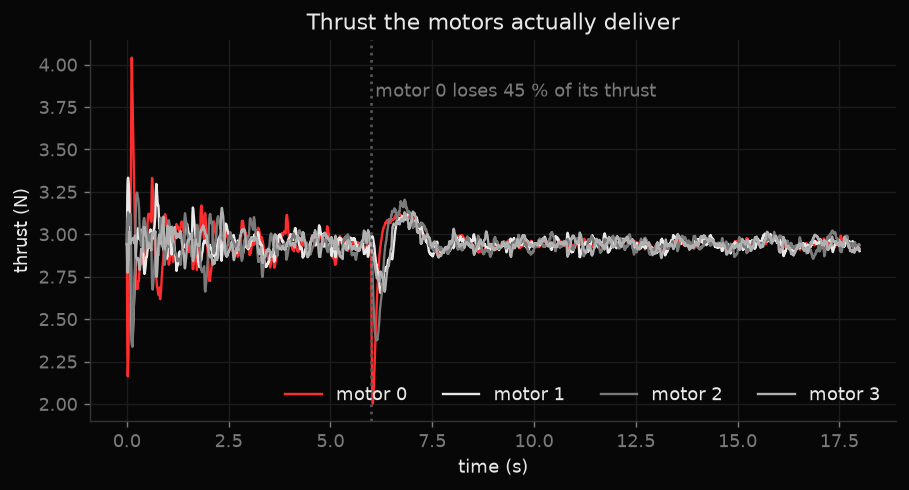

# hover

A quadrotor flight-controller simulator in Python. It has rigid-body physics, noisy sensors, a 15-state error-state Kalman filter that works out where the vehicle is and which way it is pointing, and a cascaded PID controller that flies it. Everything runs in closed loop: the controller only sees what the filter tells it.

I built it to learn how a flight stack fits together, and to be able to answer "why does it work" for each piece, not only "it works".



## What happens in a flight

The physics runs at 1 kHz: a rigid body with four lagged motors, quadratic drag and wind. The sensors sample it at their own rates, gyro and accelerometer at 250 Hz, GPS at 10 Hz, barometer and compass at 25 Hz, each with noise and bias. A 15-state error-state Kalman filter turns those into a position, velocity and attitude estimate. The controller runs at 250 Hz and is a cascade: position error gives a wanted velocity, that gives a wanted acceleration, that gives a wanted attitude, that gives body rates, and the mixer turns body rates into four motor commands.

| Part | File | In short |
|---|---|---|
| Physics | `hover/dynamics.py` | Position, velocity, quaternion, body rates and four motors with first-order lag. RK4 at 1 kHz. Quadratic drag, wind, a floor. |
| Sensors | `hover/sensors.py` | Gyro and accelerometer with noise and a random-walk bias, GPS, barometer, compass. |
| Estimator | `hover/estimator.py` | Integrates the IMU, corrects with GPS, barometer and compass. Estimates position, velocity, attitude, gyro bias and accelerometer bias. |
| Controller | `hover/controller.py` | Cascaded loops from position error down to motor thrusts, with a mixer that sacrifices torque before thrust when motors saturate. |
| Trajectories | `hover/trajectory.py` | Hold, step, minimum-jerk waypoints, a figure of eight with a smooth start. |
| Scenarios | `hover/scenarios.py` | Takeoff, step, square, figure of eight, gusts, motor loss. |

## Run it

```
pip install -e .[dev]
pytest                              # 23 tests, about 40 seconds
python scripts/make_figures.py      # redraws everything in docs/img
```

```python
from hover import run, SCENARIOS

log = run(SCENARIOS["figure8"](), seed=3)
print(log.summary())
# {'scenario': 'figure8', 'tracking_rms_m': 0.095, 'estimate_pos_rms_m': 0.05,
#  'estimate_att_rms_deg': 0.3, 'max_tilt_deg': 28.8, 'final_error_m': 0.104}
```

`run(..., use_truth=True)` feeds the controller the true state instead of the estimate, which shows how much the filter costs.

## Results

Seed 3, default parameters (a 1.2 kg quad, sensor noise typical of cheap hobby hardware):

| Flight | Result |
|---|---|
| Figure of eight, 3.5 m/s, 3 m/s² sideways | 0.10 m rms from the reference, tilts up to 29 degrees |
| 3 m step | 14 cm overshoot, 90 % of the step in 1.3 s, within 5 % after 1.4 s |
| 6 m/s gust plus turbulence | pushed up to 0.43 m, back within 10 cm by the end of the run |
| One motor drops to 55 % thrust | stays within 0.31 m and never drops below 1.3 m |
| Attitude estimate | about 0.3 degrees rms in flight |
| Position estimate | about 6 cm rms with 25 cm GPS noise |



### The estimator

The attitude comes out to about a third of a degree, and the filter learns the gyro bias, which starts at up to 0.03 rad/s, to within a thousandth after a few seconds:



### Step, gust, motor loss

| | |
|---|---|
|  |  |



When motor 0 weakens, the integrators in the velocity and rate loops push the other three to hold the vehicle level, and motor 0 is commanded to about 5.3 N to make up its share. That works because each motor has 8 N available and hover needs 2.9 N. A motor failing completely, or an airframe already near its limit, would not be saved by this controller.

## What I checked

- Free fall follows the formula, hover thrust balances weight, differential thrust gives the roll rate torque divided by inertia, and a torque-free asymmetric body conserves its angular momentum and energy under RK4.
- Quaternion helpers round-trip, compose like rotation matrices, and stay unit length under a fast spin.
- Whole flights: the controller settles a takeoff, tracks a figure of eight inside 25 cm, and recovers from a gust and a weak motor. The estimator tracks the truth within 1 degree and 20 cm in every flight and learns the gyro bias. The same seed gives the same flight.

Design notes, including the two bugs the tests found: [docs/DESIGN.md](docs/DESIGN.md).

## Limits

- No sensor delay. A real GPS reports where you were 100 ms or more ago, and the filter would need to handle that.
- Wind is not estimated. Gusts show up as a velocity disturbance that the integrator takes out.
- Drag is a simple linear plus quadratic model with no dependence on tilt, and there is no rotor flapping or ground effect.
- The "floor" only stops the vehicle falling through. Landing and crash behaviour are not simulated.
- Tuned by hand for this one airframe. There is no automatic tuning.
- Physics is in Python with NumPy: roughly 4 seconds of wall time for 15 seconds of flight.

MIT licence.
